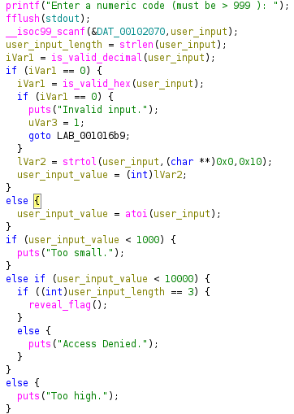
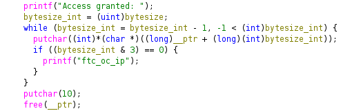
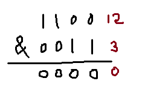
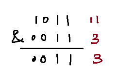

# Gatekeeper

## Process

- The question provides a ELF file `gatekeeper`
- After executing it, it asks me to provide a number larger than 999.
- If I provide a number smaller than 1000, it returns `the number is too small`. If I provide a number larger than 1000 but smaller than 10000, it returns `Access Denied`. If I provide a number larger than 10000, it returns `Too High.`
- It seems the access logic is a bit complicated and may have multiple rules.

### Trying objdump

- The first thing I tried is to use objdump. I paid attention to what kind of functions are used.
- Searching for functions. I see a `is_valid_hex` and a `is_valid_decimal` function. It suggests that besides entering a decimal number, I can also try a hexadecimal input.
- I also see a `reveal_flag` function, that should control how the flag is being printed.

---

### Ghidra analysis

Let's take a look at the `main` function on how the access control logic is built. I also did some renaming of the variables and parameter for readability.

We can see that the only execution path to get `reveal_flag` function is to

1. have a integer value larger than 1000, but smaller than 10000
2. the length of the user input (since we are inputting a string) has to be 3 characters long

If we input a decimal number, the above execution path can never be true.
However the program also validates the input string as a hexadecimal number, meaning we can input a hexadecimal number of 3 characters long.

In this case, I choose `fff` as the string, but in theory there are other answer.

---

### Encoded Flag

After giving the hexadecimal string, the program returns `}026ftc_oc_ipc905ftc_oc_ip9_99ftc_oc_ip9_TGftc_oc_ip_xehftc_oc_ip_tigftc_oc_ipid_3ftc_oc_ip{ymeftc_oc_ipdacaftc_oc_ip`.

It seems that the `reveal_flag` function has done some extra operations on the normal flag. Let's take a look at ghidra

The program set up a for loop that counts from the last index of the flag to the first index of the flag, and output the corresponding characters one-by-one. Therefore the encoded flag should be reversed to obtain the real flag.

Also, the program periodically insert the string `ftc_oc_ip` to the output. They need to remove from the encoded flag as well.

So the solution is simple, remove all occurences of `ftc_oc_ip`, then reverse the string to obtain the flag.

---

### Extra step: & operator

When does the program add the string `ftc_oc_ip`? Whenever `bytesize_int & 3 == 0`.

Then what does `&` do? It is a bitwise operator that performs AND operation to the byte value of both number bit-by-bit (i.e. only if both bits are 1, then it returns 1, else returns 0).

Here is a demonstration on `12 & 3`. The output should be `0`

Here is another demonstration on `11 & 3`. The output should be `3`.

Beware if the two numbers are different in the number of bits, the smaller one will be padded with leading 0s.

We can see that the only time `bytesize_int & 3 == 0`, is when the number has the first two LSB of `11`, meaning every 4 iteration, the condition will be triggered. This is also supported by the encoded flag, as we can see that every 4 character there is an occurence of `ftc_oc_ip`.
