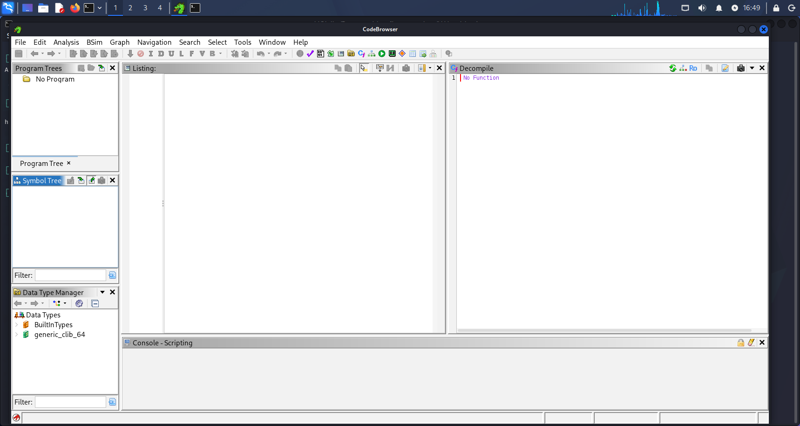
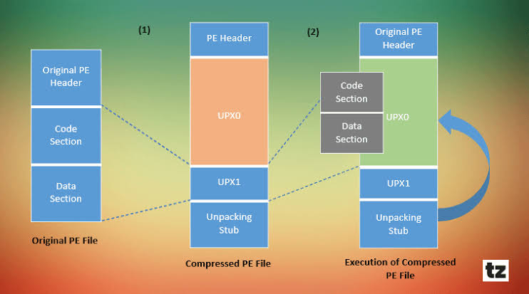
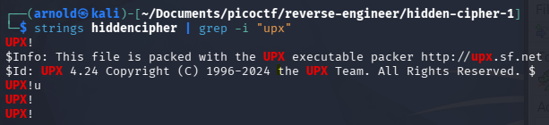
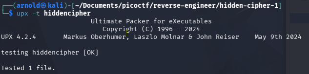
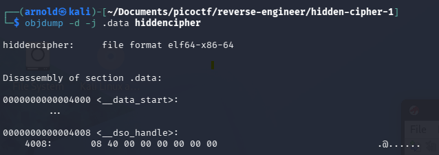
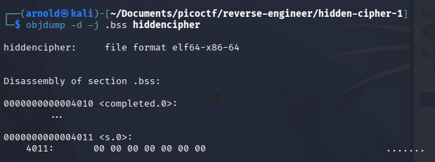
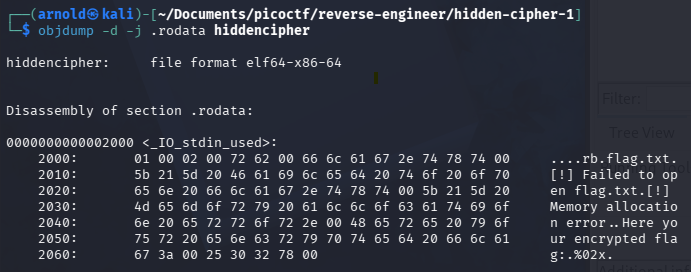
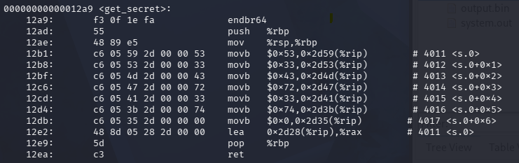

# Hidden Cipher 1

## Process

- The question provides a zip file. It contains a flag.txt and a ELF `hidden-cipher`
- The flag.txt seems a bit redundant as I already know the flag must be in the format of `picoCTF{xxx}`
- I try executing `hidden-cipher`. It shows the encrypted flag in a hexstring `235a201d70201548251358110c552f135409`
- Next thing I wanted to find out is how this flag is being encrypted into the hexstring. However, there is no clue in the question text. So I go through the clues:
  - 1 The binary can be unpacked using a tool that's often pre-installed on Linux
  - 2 The program hides a secret. Look at how it's defined and used.
  - 3 Think XOR. What happens when you XOR something twice with the same key?
- The encryption seems to be an XOR. If I know the key, then I can XOR it with the encrypted flag and get the original flag. Therefore, the next goal is to find the key.

### Key finding

- The key could be in the binary. I try putting it into Ghidra. Nothing is shown.
  
- I suspect the binary is being encrypted / obfuscated by somehow (as hint 1 has suggested), but I don't know how.

---

### Gap 1: What is Packing on binary? UPX

Packing is a method to compress / encrypts a binary file, wrap it into a smaller execution routine (stub). The primary goals are to reduce the filesize, and to avoid reverse enginnering.

- One of the common packer I found is UPX (Ultimate Packer for eXecutables)
- All the code section and data section of the program is compressed into UPX section

To confirm the binary is packed by UPX,

1. `strings hiddencipher | grep -i upx`

2. `upx -t hiddencipher`

Showing that the binary is packed by UPX

---

### Key finding (cont)

- The next thing to do is to unpack the compressed binary with `upx -d hiddencipher`
- Instead of putting it into Ghidra, I want to use `objdump` for learning purposes.
- Since Hint 2 says that the program hides a secret, I suspect the secret is hidden in two way:
  1. It is declared as a plaintext / variable / constant in the program
  2. It is generated by some kind of functions
- For case 1, we take a look at the `.data` , `.bss` (less likely as they are not initialised) and `.rodata`(string literals). It seems that the secret was not there.

- For case 2, we take a look at the `.text` section.

- There is a `get_secret` function. I suspect it contains the secret / generate the secret by some means. But I can't understand the assembly code. I need to go through it line by line.

### Gap 2: Understanding assembly code

| Line                                   | Description                                                                                                                                                                                                                                                                                          |
| -------------------------------------- | ---------------------------------------------------------------------------------------------------------------------------------------------------------------------------------------------------------------------------------------------------------------------------------------------------- |
| `endbr64`                              | End branch of 64bit. It is put at the beginning of most functions to prevent Indirect Branch Tracking(IBT). Should be irrelevant to this case.                                                                                                                                                       |
| `push   %rbp `   `mov    %rsp,%rbp` | This instruction is the standard first step of a function's prologue (the setup sequence executed whenever a function is called). `push %rbp` saves the current value of the Base Pointer register (%rbp) onto the top of the Stack. `mov    %rsp,%rbp` moves the base pointer to the stack pointer. |
| `movb   $0x53,0x2d59(%rip)`            | This looks interest as it moves some bytes literal into a place relative to the location of the instruction pointer. And accessing a global variable is usually done through relative to %rip                                                                                                        |

The `movb` instruction is repeatedly used. It seems that `get_secret` is trying to write an array. I try to see what are all the bytes literals that are added into the array.

`$0x53, $0x33, $0x43, $0x72, $0x33, $0x74, $0x0` = `S3cr3t` (`$0x0` is a null pointer, indicating the end of string)

It seems that `S3cr3t` is the key.

### XOR

Now we suspect `S3cr3t` is the key. What we need to do is as follows:

1. Turn the hexstring `235a201d70201548251358110c552f135409` into bytes
2. XOR (1) with `S3cr3t`. Iterate `S3cr3t` until the end
3. The result should be original flag.

---

## Takeaway Summary

1. UPX is a compression method.
2. .data section, .bss section, .text section
3. Assembly Code
