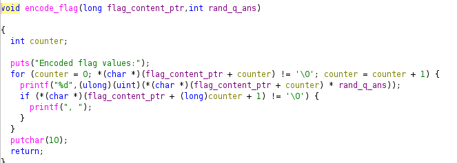

# Hidden Cipher 1

## Process

- The question provides a zip file. It contains a flag.txt and a ELF `hidden-cipher-2`
- The flag.txt seems a bit redundant as I already know the flag must be in the format of `academy{xxx}`
- I try executing `hidden-cipher-2`. It first asks a simple math question. After giving the answer, the program returns the encoded flag values, that looks something like this `Encoded flag values: 291, 297, 291, 300, 303, 327, 363, 369, 306, 291, 321, 303, 285, 306, 324, 291, 309, 375`
- Next thing I wanted to find out is how this flag is being encoded. For that I want to take a look at the binary.

### Trying objdump

- The first thing I tried is to use objdump. There are two things that I paid attention to: constants and functions.
- Searching in the data section and rodata section. No special string or values.
- Searching for functions. I see a `read_flag_file` and a `encode_flag` function. It suggests that the flag is first read from an external text file, and encode in some way. We need to take a look at what `encode_flag` really does.

---

### Ghidra analysis

Let's take a look at the `encode_flag` function. I also did some renaming of the variables and parameter for readability.

There is a for loop that read each character in the flag string one at a time. In each iteration, the ascii value of the character is multiplied by the answer of the math question. That results in the list of encoded flag values that we see in the beginning.

---

### Solution

- The solution is very simple. Reverse the operation by:

1. divide each encoded value by the math question's answer
2. turn the ascii code into character
